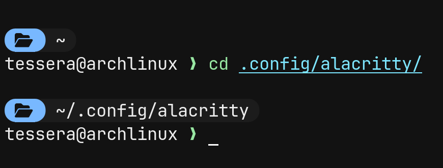
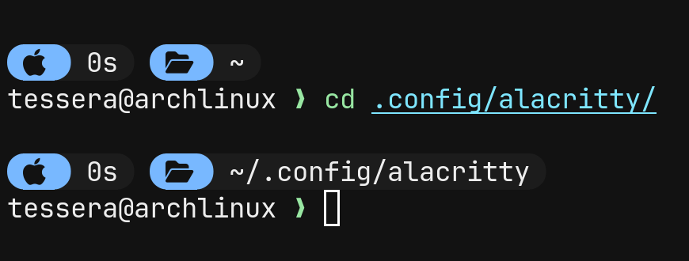

# My Config Starsip

<p align="left">
  <a href="https://starship.rs"></a>
  <a href="https://www.nerdfonts.com/"></a>
  <a href="LICENSE"></a>
</p>

**Sky Capsule** is a clean, minimal, and customizable [Starship](https://starship.rs) prompt configuration featuring modern capsule-style segments.

Designed for developers and terminal enthusiasts who want a stylish terminal without sacrificing readability or functionality.

## Preview
|||
|:---|:---:|
| **Default** |  |
| **Apple** |  |

Choose the style that fits your terminal setup and follow the installation instructions below.

---

## Features

- **Capsule-style design** — clean segments with a modern appearance.
- **Two visual styles** — Default and Apple.
- **Starship-powered** — works with multiple shells.
- **Customizable** — edit the configuration to suit your preferences.
- **Nerd Font support** — properly rendered icons and special symbols.

## Requirements

Before installing Sky Capsule, make sure you have the following:

- A supported operating system: Linux, macOS, or Windows.
- A shell supported by Starship, such as Bash, Zsh, Fish, or PowerShell.
- [Starship](https://starship.rs/) installed and configured.
- A compatible [Nerd Font](https://www.nerdfonts.com/) installed and selected in your terminal.

**Important:** Installing a Nerd Font is essential for the intended appearance. Without it, some icons and separators may appear as empty squares, question marks, or other incorrect characters.

---

## Installation

### 1. Install Starship

If you haven't installed Starship yet, follow the instructions for your operating system.

**Linux and macOS**

Open your terminal and run:

```bash
curl -sS https://starship.rs/install.sh | sh
```

**Windows**

If you use Windows Package Manager (`winget`), run the following in PowerShell:

```powershell
winget install --id Starship.Starship
```

You can also use the official [Starship installation guide](https://starship.rs/guide/).

### 2. Install a Nerd Font

Sky Capsule uses special glyphs to create its capsule-style appearance.

A recommended option is **JetBrainsMono Nerd Font**.

1. Visit [Nerd Fonts](https://www.nerdfonts.com/).
2. Download your preferred patched font.
3. Install the font on your system.
4. Open your terminal emulator's settings.
5. Find the font or font-family option.
6. Select the installed Nerd Font.

For example, in Alacritty, your configuration may look like this:

```toml
[font]
normal = { family = "JetBrainsMono Nerd Font", style = "Regular" }
```

Make sure the font family matches the name of the font installed on your system.

**Restart your terminal** after changing the font if the changes don't appear immediately.

### 3. Clone the repository

Clone the project and enter its directory:

```bash
git clone https://github.com/bogdantalant/My-config-Starship.git
cd My-config-Starship
```

Alternatively, download the repository as a ZIP archive from GitHub and extract it.

### 4. Choose a variant

Sky Capsule includes two styles:

- **Default** — the standard Sky Capsule appearance.
- **Apple** — an alternative style inspired by Apple's visual design.

Choose the configuration file corresponding to the style you want.

Copy that file to Starship's configuration path:

**Linux and macOS**

```bash
mkdir -p ~/.config
cp <path-to-selected-config> ~/.config/starship.toml
```

Replace `<path-to-selected-config>` with the actual path to the configuration file you selected.

**Windows PowerShell**

```powershell
New-Item -ItemType Directory -Force "$HOME\.config"
Copy-Item "<path-to-selected-config>" "$HOME\.config\starship.toml"
```

Replace the placeholder with the actual path to your selected configuration file.

> **Note:** Copying the selected configuration replaces the contents of an existing `starship.toml`. Back up your current configuration first if you want to keep it.

### 5. Enable Starship in your shell

Starship needs to be initialized by your shell before it can display the prompt.

Use the instructions for your shell.

**Bash**

Add the following line to the end of `~/.bashrc`:

```bash
eval "$(starship init bash)"
```

**Zsh**

Add the following line to the end of `~/.zshrc`:

```bash
eval "$(starship init zsh)"
```

**Fish**

Add the following line to `~/.config/fish/config.fish`:

```fish
starship init fish | source
```

**PowerShell**

Add the following line to your PowerShell profile:

```powershell
Invoke-Expression (&starship init powershell)
```

If Starship is already initialized in your shell, you don't need to add the initialization line again.

For additional shells and operating-system-specific instructions, see the [official Starship guide](https://starship.rs/guide/).

### 6. Restart your terminal

Close and reopen your terminal, or reload your shell configuration.

Your Sky Capsule prompt should now appear.

If it doesn't, check the troubleshooting section below.

---

## Alacritty Configuration

This section is optional and applies specifically to users of [Alacritty](https://alacritty.org/).

The following settings configure selection behavior, enable copying selected text to the clipboard, and customize which characters Alacritty treats as word boundaries.

Add the following to your Alacritty configuration file:

```toml
[selection]
save_to_clipboard = true
semantic_escape_chars = ''',│`|:\"' ()[]{}<>\t'''
```

### What do these settings do?

- **`save_to_clipboard = true`** — automatically copies selected text to the clipboard.
- **`semantic_escape_chars`** — defines characters that affect semantic text selection, such as selecting a word by double-clicking.

If your configuration already contains a `[selection]` section, update the existing section instead of creating a duplicate.

Save the file and restart Alacritty if necessary.

**Note:** These settings are specific to Alacritty. Other terminal emulators have their own configuration formats and clipboard options.

---

## Customization

Sky Capsule uses Starship's TOML configuration format.

The active configuration is normally located at:

```text
~/.config/starship.toml
```

On Windows, the corresponding location is:

```text
%USERPROFILE%\.config\starship.toml
```

You can open this file in any text editor and modify the configuration.

For example, you can adjust:

- Prompt colors and styles.
- Segment formatting and separators.
- Icons and symbols.
- Which prompt modules are displayed.
- Spacing and other visual details.

Refer to the [Starship configuration documentation](https://starship.rs/config/) for a complete list of available options.

**Tip:** Keep a backup of your working configuration before making changes.

---

## Troubleshooting

### Icons appear as squares or question marks

Your terminal may not be using a compatible Nerd Font.

**Fix:**
1. Install a patched Nerd Font.
2. Select it in your terminal settings.
3. Restart your terminal.

### The prompt looks different from the preview

Make sure you copied the intended configuration file and selected the correct font.

Some differences can also result from terminal rendering, font settings, or shell-specific behavior.

### Starship doesn't appear

Check whether Starship is installed:

```bash
starship --version
```

If the command is not found, install Starship and ensure its executable is available in your `PATH`.

Next, verify that Starship is initialized in your shell's configuration file.

### Changes to the configuration don't appear

Make sure you edited the configuration file that Starship actually uses.

By default, Starship reads `~/.config/starship.toml`, unless another path is specified through the `STARSHIP_CONFIG` environment variable.

Restart your shell after making changes.

### Alacritty reports a configuration error

Check that the TOML syntax is valid and that the `[selection]` section isn't duplicated.

Consult the [Alacritty documentation](https://alacritty.org/) if you need help with terminal-specific settings.

---

## Project Structure

The repository contains the Sky Capsule configuration, preview images, and project documentation.

```text
My-config-Starship/
├── image/
│   ├── starship-default.png
│   └── starship-apple.png
├── README.md
└── LICENSE
```

*This is an illustrative overview. Additional configuration files or directories may exist in the repository.*

---

## Credits

- [Starship](https://starship.rs/) — the cross-shell prompt engine.
- [Nerd Fonts](https://www.nerdfonts.com/) — patched fonts for icons and special glyphs.
- [Alacritty](https://alacritty.org/) — a GPU-accelerated terminal emulator.

## License

This project is distributed under the license specified in the [`LICENSE`](LICENSE) file.
